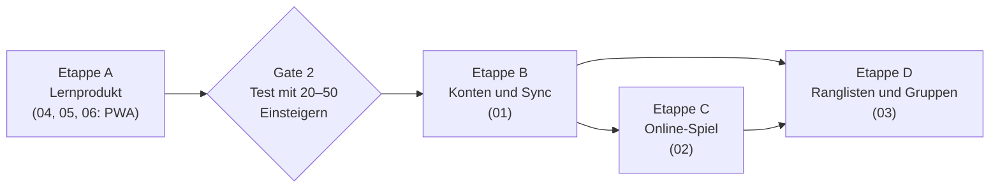

# Pokerschule – Roadmap der nächsten Features

Stand: 9. Oktober 2026 · Grundlage: Lastenheft Pokerschule, Website auf https://pokerschule.vercel.app

## Wo wir stehen

Die Pokerschule läuft als Website ohne Server: Spielen gegen Bots (Arena, Preflop-Duell), Training (Flop, River, Fehler-Training, drei Quiz), Lernen, Statistik und eine Rangliste gegen Referenzspieler. Jede Entscheidung wird gegen einen Solver bewertet, der Fortschritt liegt im Browser.

Phase 1 des Lastenhefts ist abgeschlossen. Aus Phase 2 sind zwei Punkte bereits erfüllt: Solver-Daten werden pro Modus nachgeladen (B-02), und der Startdownload liegt bei rund 96 KB statt der geforderten 500 KB.

## Ziel

Am Ende soll die Pokerschule für Poker sein, was chess.com für Schach ist: ein Ort, an dem man lernt, trainiert, gegen Menschen spielt, sein Rating verfolgt und sich mit anderen vergleicht. Der Unterschied zum Schach bleibt Kern des Produkts: Bewertet wird die Entscheidung, nicht das Glück der Karten.

## Die Dokumente

| Nr. | Dokument | Inhalt | Lastenheft |
|---|---|---|---|
| 01 | [Konten und Synchronisierung](01-konten-und-sync.md) | Backend, Anmeldung, Fortschritt auf allen Geräten | D-04 |
| 02 | [Online-Spiel gegen Menschen](02-online-spiel.md) | Matchmaking, Live-Tisch, glücksbereinigtes Rating | neu (Ziel „wie chess.com“) |
| 03 | [Ranglisten und Gruppen](03-ranglisten-und-gruppen.md) | Bestenlisten, Gruppen, Wochen-Challenges | D-05 |
| 04 | [Content-Ausbau](04-content-ausbau.md) | 60 Flops, Turn, ganze Hände, 3-Bet-Pots, 6-max, Bot-Stile | B-01, B-03 bis B-07 |
| 05 | [Lernsystem](05-lernsystem.md) | Lektionen, „Warum“-Erklärungen, adaptive Auswahl, Wiederholung | C-01 bis C-06 |
| 06 | [Plattform](06-plattform.md) | Offline-App, Hand-Import, Englisch, Qualität | D-03, D-06, D-07 |

## Empfohlene Reihenfolge

Die Reihenfolge folgt den Gates des Lastenhefts: Erst wenn Einsteiger die App wiederholt nutzen (Gate 2), lohnen sich laufende Kosten für ein Backend.

| Etappe | Inhalt | Ziel | Grober Aufwand* |
|---|---|---|---|
| A – Lernprodukt | Konzept-Lektionen, „Warum“-Erklärungen, adaptive Auswahl, 60 Flops, Turn-Training, ganze Hände, PWA | Abnahme Phase 2 | 6–9 Wochen |
| Gate 2 | Test mit 20–50 Einsteigern, Auswertung | Entscheidung über Backend | 2–3 Wochen |
| B – Konten | Backend, Anmeldung, Sync, Datenschutz | Fortschritt auf zwei Geräten | 3–4 Wochen |
| C – Online-Spiel | Matchmaking, Live-Tisch, Server-Logik, Rating | Erste Matches zwischen Menschen | 5–7 Wochen |
| D – Community | Ranglisten, Gruppen, Challenges | Eine Gruppe im Echtbetrieb | 3–4 Wochen |

\* Ein Entwickler neben Studium und Werkstudentenstelle, etwa 10–15 Stunden pro Woche.

## Kosten

| Posten | Bis Etappe A | Ab Etappe B |
|---|---|---|
| Hosting (Vercel) | 0 € (Hobby) | 0–20 €/Monat (Pro, sobald kommerziell oder mehr Traffic) |
| Backend (Supabase) | – | 0 € (Free) bis 25 $/Monat (Pro, ab ~500 aktiven Nutzern oder für Backups) |
| Domain | optional ~15 €/Jahr | ~15 €/Jahr |
| Rechtsberatung | – | einmalig für Datenschutz bei Konten empfohlen |

## Grundsätze, die für alle Features gelten

- **Kein Echtgeld.** Keine Einsätze, keine geldwerten Preise, keine Affiliate-Links zu Pokeranbietern.
- **Keine Hilfe in Echtgeld-Sessions.** Kein Overlay, kein Bildschirm-Auslesen, Hand-Import nur nachträglich.
- **Transparenz.** Jede Bewertung nennt ihr Modell und dessen Grenzen.
- **Ohne Konto voll nutzbar.** Konten sind ein Zusatz, keine Pflicht.
- **Qualität.** Kernlogik getestet (mindestens 80 % Abdeckung), Tests bei jedem Push, WCAG 2.1 AA, mobil ab 360 px.
