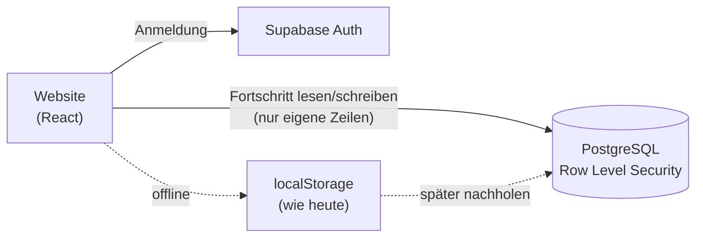

# 01 · Konten und Synchronisierung

Lastenheft: **D-04** (Soll, Phase 3) · Voraussetzung für 02 und 03

## Ziel

Lernende können ein Konto anlegen und ihren Fortschritt auf mehreren Geräten nutzen. Ohne Konto bleibt alles wie heute nutzbar.

## Nutzen

- Fortschritt geht nicht verloren, wenn Browserdaten gelöscht werden.
- Handy unterwegs, Laptop zu Hause: ein Rating, eine Fehlerliste.
- Grundlage für Online-Spiel, Ranglisten und Gruppen.

## Umfang

| Priorität | Funktion |
|---|---|
| Muss | Anmeldung per E-Mail-Link (ohne Passwort) |
| Muss | Fortschritt synchronisieren: Ratings, Statistik, Fehlerliste, Einstellungen |
| Muss | Beim ersten Anmelden den lokalen Fortschritt übernehmen (Zusammenführen statt Überschreiben) |
| Muss | Konto und alle Daten selbst löschen; Datenexport als Datei |
| Soll | Anmeldung mit Apple und Google |
| Soll | Öffentliches Profil mit Anzeigename, Ratings und Mitglied-seit (abschaltbar) |
| Kann | Avatar aus einer festen Auswahl (keine eigenen Uploads, kein Moderationsaufwand) |

## Ablauf für Nutzer

1. Oben rechts erscheint „Anmelden“. Ohne Konto ändert sich nichts.
2. E-Mail eingeben, Link im Postfach öffnen, fertig.
3. Beim ersten Anmelden: „Du hast in diesem Browser 312 Entscheidungen und 14 offene Fehler. Mit deinem Konto verbinden?“
4. Danach wird jede Änderung im Hintergrund gesichert. Ohne Netz wird lokal weitergespeichert und später nachgeholt.

## Technik

**Backend: Supabase** (PostgreSQL, Auth, Row Level Security, Realtime, Edge Functions). Gründe: kostenloser Einstieg, Datenbank und Anmeldung aus einer Hand, Realtime für das Online-Spiel (02), EU-Region (Frankfurt) wählbar.

### Datenmodell (Auszug)

| Tabelle | Inhalt |
|---|---|
| `profiles` | id, Anzeigename, öffentlich ja/nein, erstellt am |
| `progress` | user_id, Speicherstand v2 als JSON, Version, aktualisiert am |
| `decisions` | user_id, Modus, Situation, Einstufung, EV-Verlust, Zeitpunkt (Grundlage für Statistik und Ranglisten) |

### Synchronisierung

- Der heutige Speicherstand (Schema v2) wird als Ganzes gespeichert; Zusammenführen pro Bereich: höhere Anzahl Entscheidungen gewinnt, Fehlerlisten werden vereinigt.
- Entscheidungen werden zusätzlich als einzelne Zeilen gespeichert, damit Ranglisten serverseitig berechnet werden können.
- Konflikte (zwei Geräte gleichzeitig): letzte Schreibung pro Bereich gewinnt, Fehlerlisten werden vereinigt.

## Datenschutz und Recht

- EU-Region, Auftragsverarbeitungsvertrag mit Supabase und Vercel.
- Datenschutzerklärung erweitern: Kontodaten, Zweck, Speicherdauer, Löschung.
- Datensparsam: nur E-Mail und Anzeigename. Kein Klarname, kein Geburtsdatum.
- Altershinweis „ab 18“ wird beim Anlegen des Kontos bestätigt.
- Löschen des Kontos entfernt alle Zeilen sofort; Backups laufen nach spätestens 30 Tagen aus.

## Abnahmekriterien

- Fortschritt ist nach Anmeldung auf zwei Geräten identisch (Lastenheft Phase 3).
- Ohne Konto funktioniert alles wie bisher; kein Netz → kein Fehler, nur verzögerte Sicherung.
- Ein Nutzer kann keine Daten anderer lesen oder schreiben (Test gegen die Sicherheitsregeln).
- Konto löschen und Daten exportieren funktionieren ohne Support.

## Aufwand und Risiken

- Aufwand: 3–4 Wochen.
- Risiko Zusammenführen: Fehler hier zerstören Fortschritt → vor dem Zusammenführen automatisch eine lokale Sicherung anlegen.
- Risiko Kosten: Free-Tarif reicht für den Start; ab etwa 500 aktiven Nutzern Pro-Tarif einplanen.

## Umsetzungsstand (9. Oktober 2026)

Umgesetzt im Code, Inbetriebnahme siehe [Konten einrichten](../konten-einrichten.md):

| Funktion | Stand | Wo |
|---|---|---|
| Anmeldung per E-Mail-Link, zusätzlich Code-Eingabe | fertig | `src/modes/account.js`, Seite `/konto` |
| Anmeldung mit Apple und Google | fertig, per `VITE_AUTH_PROVIDERS` zuschaltbar | |
| Synchronisierung mit Konfliktauflösung, Offline-Nachholen | fertig | `src/core/sync.js` (getestet), `src/modes/account.js` |
| Rückfrage und lokale Sicherung beim ersten Verbinden | fertig | |
| Entscheidungen als einzelne Zeilen | fertig, ab der Anmeldung (frühere Entscheidungen nur im Speicherstand) | Tabelle `decisions` |
| Konto löschen, Datenexport | fertig | `delete_account()`, Seite `/konto` |
| Öffentliches Profil, Avatar aus fester Auswahl | fertig | `/spieler/:name` |
| Sicherheitsregeln (RLS) und Tests | geschrieben, noch nicht gegen eine Supabase-Instanz gelaufen | `supabase/migrations`, `supabase/tests` |
| Datenschutzerklärung | erweitert, Platzhalter zu Supabase prüfen | `src/web/pages/Legal.jsx` |

Offen: Supabase-Projekt anlegen, AVV abschließen, SMTP-Anbieter, Abnahme auf zwei echten Geräten.
