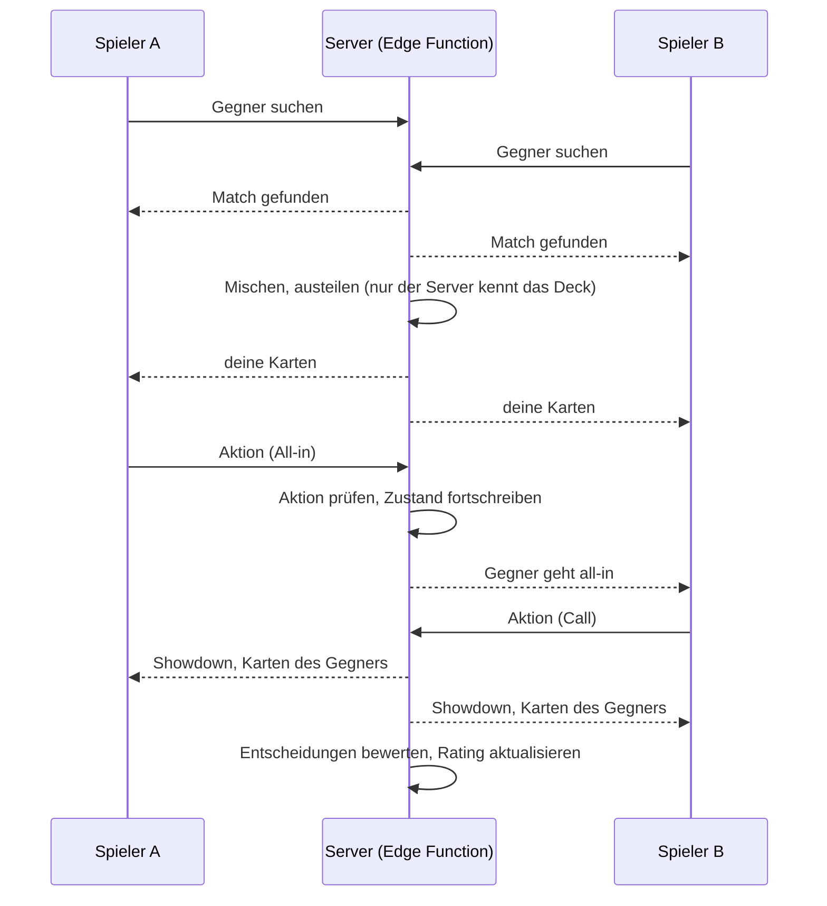

# 02 · Online-Spiel gegen Menschen

Ziel „wie chess.com“ · Voraussetzung: 01 Konten

## Ziel

Lernende spielen Heads-up gegen andere Menschen, ohne Echtgeld. Das Rating misst, wie gut sie entscheiden, nicht wer die Karten gewinnt. Nach jedem Match gibt es eine Analyse wie heute gegen Bots.

## Nutzen

- Motivation durch echte Gegner und ein vergleichbares Rating.
- Echte Gegner machen echte Fehler; das Gelernte wird unter realistischen Bedingungen geübt.
- Kernversprechen bleibt: Glück verzerrt das Rating nicht.

## Umfang

| Priorität | Funktion |
|---|---|
| Muss | Formate: Push/Fold-Match (10–20 BB) und Preflop-Duell (100 BB), jeweils heads-up |
| Muss | Matchmaking nach Rating, Wartezeit sichtbar, Abbruch jederzeit |
| Muss | Bedenkzeit pro Entscheidung (z. B. 20 s + Zeitbank), Fold bei Ablauf |
| Muss | Server mischt und teilt aus; der Browser kennt die Karten des Gegners nie |
| Muss | Analyse nach dem Match: jede Entscheidung beider Spieler mit Einstufung und EV-Verlust |
| Soll | Freunde direkt herausfordern (Link teilen) |
| Soll | Revanche, Match-Verlauf im Profil |
| Kann | Postflop-Format (Flop bis River), sobald der Content dafür da ist (04) |
| Kann | Turniere mit mehreren Runden |

## Das Rating: glücksbereinigtes Elo

Im Poker entscheidet über einzelne Hände oft das Glück. Deshalb zählt nicht, wer das Match gewinnt, sondern wer besser entschieden hat:

1. Für jede Entscheidung beider Spieler wird der EV-Verlust gegenüber dem Gleichgewicht berechnet (wie heute in Arena und Duell).
2. Pro Match ergibt sich für jeden Spieler eine **Spielqualität**: durchschnittlicher EV-Verlust in BB pro 100 Entscheidungen.
3. Der Spieler mit der besseren Spielqualität „gewinnt“ die Elo-Wertung; der Abstand bestimmt, wie deutlich.
4. All-in-Hände werden zusätzlich glücksbereinigt angezeigt (Equity statt Ergebnis), damit Spieler verstehen, warum sie trotz Niederlage gut gespielt haben.

Das Ergebnis in Chips wird trotzdem angezeigt, es zählt nur nicht für das Rating. Das ist die wichtigste Produktentscheidung und muss in der Oberfläche klar erklärt werden.

## Ablauf für Nutzer

1. „Spielen“ → „Online“ → Format wählen → „Gegner suchen“.
2. Tisch wie in der Arena, mit Name, Rating und Bedenkzeit des Gegners.
3. Nach dem Match: Ergebnis, Spielqualität beider Spieler, Rating-Änderung, Analyse aller Entscheidungen, Knöpfe „Revanche“ und „Neues Match“.

## Technik

- **Autoritativer Server.** Spiellogik und Zufall laufen in einer Edge Function; der Browser schickt nur Aktionen. Gemischt wird mit einem kryptografischen Zufallsgenerator; das Deck wird nach dem Match zur Nachprüfung veröffentlicht (Hash vorher, Deck nachher).
- **Echtzeit** über Supabase Realtime-Kanäle pro Tisch.
- **Bewertung** auf dem Server mit derselben Kernlogik (`src/core`), damit niemand sein Rating manipulieren kann.
- **Verbindungsabbruch:** 60 s Wiederverbindung, danach zählt die Hand als Fold, das Match als aufgegeben.

## Fair Play

- Solver-Hilfe ist die größte Gefahr für ein Rating, das Solver-Nähe belohnt.
- Maßnahmen: Bedenkzeit-Muster und auffällig konstante Genauigkeit über viele Matches erkennen, auffällige Konten markieren, Ranglisten erst ab einer Mindestzahl Matches.
- Melden-Funktion, Sperren durch den Betreiber.

## Recht

- Kein Einsatz, kein Gewinn mit Geldwert → kein Glücksspiel im Sinne des GlüStV. Trotzdem vor dem Start rechtlich prüfen lassen.
- Altersbestätigung ab 18 beim Konto (01).
- Nutzungsbedingungen mit Fair-Play-Regeln.

## Abnahmekriterien

- Zwei Menschen können ein Push/Fold-Match zu Ende spielen; Karten des Gegners sind vor dem Showdown im Browser nicht auslesbar.
- Rating-Änderung folgt aus der Spielqualität, nicht aus dem Chip-Ergebnis (Test mit festen Szenarien).
- Verbindungsabbruch führt zu einem sauberen Matchende.
- Antwortzeit einer Aktion unter 300 ms innerhalb Europas.

## Aufwand und Risiken

- Aufwand: 5–7 Wochen.
- Risiko leere Warteschlange: Anfangs zu wenige Spieler → bei mehr als 30 s Wartezeit „Gegen Bot weiterspielen“ anbieten.
- Risiko Kosten: Realtime-Verbindungen sind im Free-Tarif begrenzt (200 gleichzeitig).
