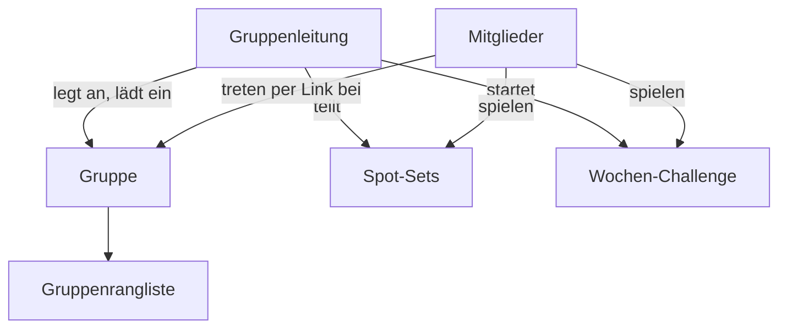

# 03 · Ranglisten und Gruppen

Lastenheft: **D-05** (Kann, Phase 3), Rolle **Gruppenleitung** · Voraussetzung: 01 Konten

## Ziel

Lernende sehen, wo sie im Vergleich zu anderen stehen, und lernen gemeinsam in Gruppen: Freundeskreis, Pokerrunde, Uni-Gruppe.

## Umfang

| Priorität | Funktion |
|---|---|
| Muss | Globale Rangliste je Modus (Arena, Duell, Flop, River, Online) und gesamt |
| Muss | Mindestzahl Entscheidungen, bevor jemand erscheint (z. B. 200), gegen Zufallsplatzierungen |
| Muss | Gruppen anlegen, per Link einladen, Gruppenrangliste |
| Soll | Wochen-Challenge: gleiche 20 Spots für alle, Wertung nach Genauigkeit |
| Soll | Gruppenleitung teilt eigene Spot-Sets (z. B. „Bluff-Catching am River“) |
| Soll | Freundesliste und Vergleich „du gegen Freund“ pro Situation |
| Kann | Saisons (Rangliste pro Monat), Abzeichen für Meilensteine |

## Ranglisten

- **Wertung:** Rating des Modus; bei gleichem Rating mehr Entscheidungen zuerst.
- **Aktivität:** Wer 30 Tage nicht spielt, wird ausgeblendet (nicht gelöscht).
- **Ansichten:** Gesamt, diese Woche (Rating-Zuwachs), Freunde, Gruppe.
- **Datenschutz:** Nur Konten mit öffentlichem Profil erscheinen; Anzeigename statt E-Mail.

## Gruppen

- Rollen: Leitung (anlegen, einladen, entfernen, Spot-Sets teilen) und Mitglied.
- Einladung per Link mit Ablaufdatum; Leitung kann den Link neu erzeugen.
- Gruppengröße zunächst bis 50 Mitglieder.

## Wochen-Challenge

1. Montag erzeugt der Server 20 Spots (gemischt aus Flop, River, Duell), für alle gleich.
2. Jeder spielt sie einmal, ohne Zeitlimit, Ergebnis erst nach Abgabe sichtbar.
3. Wertung nach durchschnittlichem EV-Verlust; Gleichstand nach Zeit.
4. Sonntag Abschluss, Analyse aller Spots mit Verteilung der Antworten („62 % haben gecallt“).

## Abnahmekriterien

- Eine Gruppe mit Rangliste läuft im Echtbetrieb (Lastenheft Phase 3).
- Rangliste zeigt nur öffentliche Profile mit ausreichend Entscheidungen.
- Challenge-Spots sind für alle gleich und können nicht vorab ausgelesen werden.

## Aufwand und Risiken

- Aufwand: 3–4 Wochen.
- Risiko Manipulation: Ranglisten belohnen Solver-Hilfe → Fair-Play-Maßnahmen aus 02 gelten auch hier.
- Risiko Leere: Am Anfang wenige Einträge → Referenzspieler (heutige Rangliste) bleiben sichtbar.

## Stand der Umsetzung

Umgesetzt am 10. Oktober 2026, Einrichtung: [../community-einrichten.md](../community-einrichten.md).

| Punkt | Stand |
|---|---|
| Globale Rangliste je Modus (Arena, Duell, Flop, River, Online Push/Fold, Online Duell) und gesamt | umgesetzt, Seite `/rangliste` |
| Mindestzahl 200 Entscheidungen bzw. 10 Matches, ausgeblendet nach 30 Tagen, nur öffentliche Profile, gesperrte Konten nie | umgesetzt |
| Ansichten Gesamt, diese Woche, dieser Monat (Saison), Freunde, Gruppe; Referenzspieler bleiben sichtbar | umgesetzt |
| Gruppen: anlegen, Einladung per Link mit Ablauf, neu erzeugen, entfernen, Leitung übergeben, bis 50 Mitglieder, Gruppenrangliste | umgesetzt, `/rangliste/gruppen` |
| Wochen-Challenge: 20 gleiche Spots, einmal spielen, Ergebnis nach Abgabe, Verteilung nach Sonntag, Wertung nach EV-Verlust und Zeit | umgesetzt, `/rangliste/woche`, Edge Function `challenge` |
| Spot-Sets der Gruppenleitung mit Übungsstand der Mitglieder | umgesetzt |
| Freundesliste (Link oder Anfrage), „du gegen Freund“ je Situation | umgesetzt, `/rangliste/freunde` |
| Abzeichen für Meilensteine | umgesetzt (Rangliste und öffentliches Profil) |
| Datenbank-Tests | in PGlite (`test/database.test.js`), noch nicht gegen ein echtes Supabase-Projekt |
| Eine Gruppe im Echtbetrieb (Abnahme Phase 3) | offen, braucht das Supabase-Projekt |

Grenze: Die Trainings-Ratings berechnet der Browser; die Ranglisten dafür lassen sich mit Aufwand fälschen. Online-Rating und Wochen-Challenge bewertet der Server.
